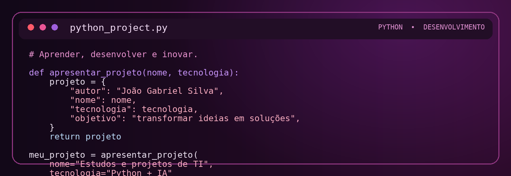

<table>
<tr>
<td width="220" align="center">

</td>
<td align="left">

# João Gabriel Silva
### Estudante de Gestão da Tecnologia da Informação | Desenvolvedor em formação

Olá! Seja muito bem-vindo(a) ao meu GitHub.

Sou estudante de Gestão da Tecnologia da Informação e entusiasta de tecnologia, programação, bancos de dados, inteligência artificial e redes de computadores. Utilizo este espaço para compartilhar projetos, estudos e experiências práticas enquanto desenvolvo minhas habilidades e construo minha trajetória na área de TI.

</td>
</tr>
</table>

---

## 🧰 Tecnologias e conhecimentos

Tecnologias e ferramentas que utilizo, estudo ou exploro em meus projetos:

## 🐍 Código e prática em Python

## 🚀 Portfólios e projetos

### 1. 📱 Aplicativo mobile com IA para estudos de programação

**Projeto principal do meu portfólio.**

Aplicativo mobile com inteligência artificial, pensado para auxiliar estudantes no aprendizado de programação. A proposta é reunir apoio ao estudo, explicações de conceitos e prática de programação em uma experiência acessível e interativa.

- Apoio ao aprendizado de programação com recursos de IA.
- Foco em estudo prático e compreensão de conceitos.
- Desenvolvimento voltado para dispositivos móveis.

🔗 **Link do projeto:** *adicione aqui o endereço do repositório ou da demonstração.*

### 2. 🐍 Códigos e projetos em Python

Repositório de exercícios, scripts e projetos desenvolvidos em Python durante meus estudos. Este espaço reúne práticas de lógica de programação, experimentos e soluções que demonstram minha evolução com a linguagem.

- Exercícios e exemplos de programação.
- Scripts e pequenas automações.
- Projetos práticos desenvolvidos durante os estudos.

🔗 **Link do repositório:** *adicione aqui o endereço do repositório Python.*

## 🎯 Objetivos profissionais

- Aprofundar conhecimentos em desenvolvimento de software.
- Evoluir em bancos de dados relacionais e não relacionais.
- Explorar aplicações práticas de inteligência artificial.
- Criar projetos que transformem conhecimento em soluções.
- Aprender continuamente e colaborar com a comunidade de tecnologia.

## 📫 Vamos conversar?

Estou aberto a conexões, troca de conhecimentos e oportunidades de colaboração em projetos de tecnologia.

- 📧 **E-mail:** [joaogabrielkaw@gmail.com](mailto:joaogabrielkaw@gmail.com)
- 📸 **Instagram:** [@9_lucio](https://www.instagram.com/9_lucio/)
- 💼 **LinkedIn:** [João Gabriel Silva](https://www.linkedin.com/in/jo%C3%A3o-gabriel-silva-b8599743b/)

---

**Obrigado por visitar meu perfil!**

*“Disciplina, estudo e tecnologia constroem novas possibilidades.”* 🚀

